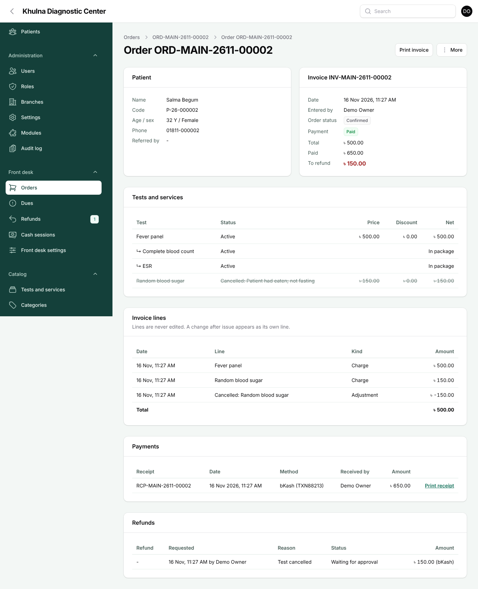

# Diagnostic Management System

A paid, module-based management system for diagnostic centers in Bangladesh:
front desk and billing, laboratory workflow, reports, finance, and owner
tools. The product name is not decided yet, so the documents use the working
title **DMS**.

## Status

**Phases 1 and 2 are built.**

- **Phase 1, skeleton:** one database per clinic, sign-in, users, roles and
  permissions, the audit log, clinic settings, branches, number counters,
  exact money handling, and the module system.
- **Phase 2, front desk and billing:** patients, the service catalog with
  packages, referral doctors, orders, invoices, discounts with role limits,
  part payments and dues, refunds with approval, cancelling and adding tests
  after issue, daily cash closing, printable invoices and receipts, and
  today's figures on the dashboard.

Laboratory work (samples, results, reports) starts in Phase 3.



## Requirements

- PHP 8.3 with the `mbstring`, `intl`, `pdo_mysql`, `gd`, and `zip` extensions
- Composer
- MySQL 8

## Setup

1. Install dependencies and create the environment file.

   ```bash
   composer install
   ```

   ```bash
   cp .env.example .env
   ```

   ```bash
   php artisan key:generate
   ```

2. Create the control database and a MySQL user for the application. The
   user needs to create databases and users, because each clinic gets its
   own database and its own MySQL user.

   ```sql
   CREATE DATABASE dms_control CHARACTER SET utf8mb4 COLLATE utf8mb4_unicode_ci;
   CREATE USER 'dms'@'127.0.0.1' IDENTIFIED BY 'choose-a-strong-password';
   GRANT ALL PRIVILEGES ON *.* TO 'dms'@'127.0.0.1' WITH GRANT OPTION;
   ```

   Put the same password in `DB_PASSWORD` in `.env`.

3. Create the control tables.

   ```bash
   php artisan migrate
   ```

4. Create a clinic. The domain is the address staff will open in the
   browser. For local work, use `localhost`.

   ```bash
   php artisan clinic:create "Demo Diagnostic Center" localhost --owner-name="Demo Owner" --owner-email=owner@example.com
   ```

   You are asked for the owner's password (at least 10 characters).

5. Start the development server and sign in at <http://localhost:8000>.

   ```bash
   php artisan serve
   ```

A request to an address that belongs to no clinic gets "not found". That
includes `127.0.0.1` unless you create a clinic with that domain.

## Commands

| Command | What it does |
|---|---|
| `php artisan clinic:create <name> <domain>` | Creates a clinic: database, tables, default roles, owner |
| `php artisan clinic:list` | Lists clinics with their domains and databases |
| `php artisan clinic:migrate` | Runs core and module migrations for every clinic. Run on every deploy |
| `php artisan migrate` | Migrates the control database only |
| `php artisan modules:list` | Lists modules in load order |
| `php artisan modules:validate` | Checks every module manifest and dependency. Fails on any problem |
| `php artisan queue:work` | Runs queued jobs. Each job reconnects to the clinic it was created for |
| `php artisan schedule:run` | Runs scheduled tasks. Call it every minute from cron in production |
| `php artisan frontdesk:summarize` | Rebuilds the daily front desk summaries. Scheduled nightly |
| `php artisan frontdesk:check-invoices` | Recalculates every invoice and reports any stored total that differs. Scheduled nightly, changes nothing |

## Tests

The fast run uses SQLite and needs no database server:

```bash
php artisan test
```

The same tests run on MySQL, plus a test that issues invoice numbers from
several processes at once, which only makes sense with real row locking:

```bash
DB_DRIVER=mysql DB_DATABASE=dmstest_control DB_USERNAME=dms DB_PASSWORD=your-password php artisan test
```

Create the `dmstest_control` database first. Test clinic databases are named
`dmstest_clinic_<n>` and are dropped after each test. `.github/workflows/tests.yml`
runs both on every push.

## How it is organised

```
app/Core/            The fixed core
  Tenancy/           Finds the clinic for a request and connects to its database
  Auth/              Users, roles, permissions, last-owner protection
  Modules/           Module registry, per-clinic on/off state, dependency checks
  Audit/             Append-only audit trail
  Numbering/         Counters and formats for invoice, patient, and other numbers
  Money/             Exact money arithmetic
  Settings/          Clinic settings
  Branches/          Branches
  Patients/          Patients, shared by every module
app/Filament/        Admin screens for the core
modules/             One folder per module
  FrontDesk/         Catalog, orders, invoices, payments, refunds, cash sessions
  Demo/              A tiny working example to copy
database/migrations/
  control/           Tables of the control database
  clinic/            Core tables of every clinic database
tests/               Core tests. Each module keeps its own under modules/<Name>/tests
```

To add a module, copy `modules/Demo`, change its `module.json`, and follow
[docs/module-standard.md](docs/module-standard.md).

## Documents

| Document | What it covers |
|---|---|
| [docs/architecture.md](docs/architecture.md) | Stack, tenancy, code structure, conventions, security, testing |
| [docs/module-standard.md](docs/module-standard.md) | How a module is described, loaded, enabled, disabled, and extended |
| [docs/schema.md](docs/schema.md) | Databases, tables, keys, indexes, number counters, state machines |
| [docs/permissions.md](docs/permissions.md) | Roles, permission keys, and the rules that protect money and results |
| [docs/feature-checklist.md](docs/feature-checklist.md) | Features compared with competitors, to fill in during clinic interviews |
| [docs/open-decisions.md](docs/open-decisions.md) | Decisions still open, with a recommendation and a deadline for each |
| [docs/phases.md](docs/phases.md) | The build phases and how each one ends |
