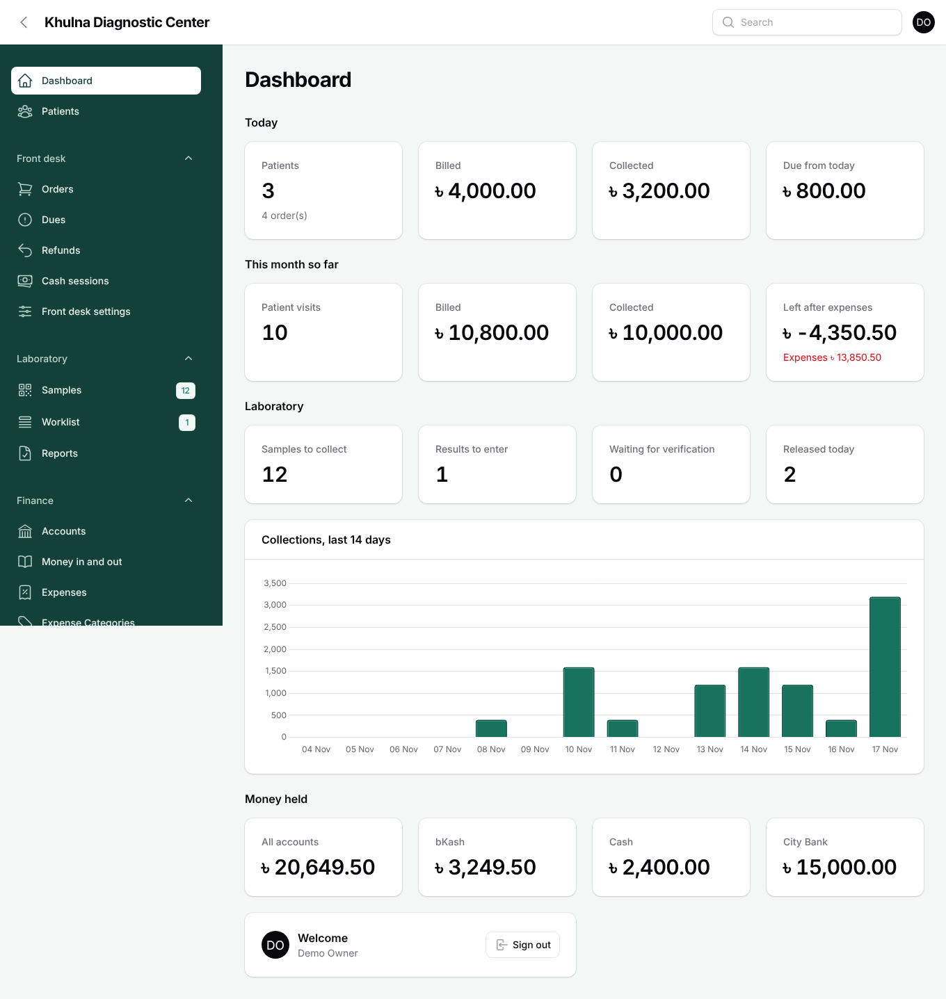

# Diagnostic Management System

A paid, module-based management system for diagnostic centers in Bangladesh:
front desk and billing, laboratory workflow, reports, finance, and owner
tools. The product name is not decided yet, so the documents use the working
title **DMS**.

## Status

**Phases 1 to 5 are built.**

- **Phase 1, skeleton:** one database per clinic, sign-in, users, roles and
  permissions, the audit log, clinic settings, branches, number counters,
  exact money handling, and the module system.
- **Phase 2, front desk and billing:** patients, the service catalog with
  packages, referral doctors, orders, invoices, discounts with role limits,
  part payments and dues, refunds with approval, cancelling and adding tests
  after issue, daily cash closing, printable invoices and receipts, and
  today's figures on the dashboard.

- **Phase 3, laboratory and reports:** lab tests with analytes and reference
  ranges by sex and age, samples with barcode labels, result entry with
  automatic flags, verification by a second person, amendments that keep
  every version, and PDF reports with letterhead and signatories.

- **Phase 4, owner basics:** accounts for cash, bank, and mobile money that
  fill themselves from payments; expenses; referral commission with payouts;
  a profit report; an owner dashboard with this month's figures and a
  collections chart; sales reports by day, test, doctor, and cashier; and a
  full export of the clinic's data.

- **Phase 5, performance and safety:** every screen timed against two years
  of simulated data and the slow ones fixed; backups with a trial restore;
  two-step sign-in; database-level protection of the audit trail; and a
  security review.

Next is Phase 6: a pilot at one real clinic.



A sample report is in
[docs/screenshots/sample-lab-report.pdf](docs/screenshots/sample-lab-report.pdf).

## Requirements

- PHP 8.3 with the `mbstring`, `intl`, `pdo_mysql`, `gd`, and `zip` extensions
- Composer
- MySQL 8

## Setup

1. Install dependencies and create the environment file.

   ```bash
   composer install
   ```

   ```bash
   cp .env.example .env
   ```

   ```bash
   php artisan key:generate
   ```

2. Create the control database and a MySQL user for the application. The
   user needs to create databases and users, because each clinic gets its
   own database and its own MySQL user.

   ```sql
   CREATE DATABASE dms_control CHARACTER SET utf8mb4 COLLATE utf8mb4_unicode_ci;
   CREATE USER 'dms'@'127.0.0.1' IDENTIFIED BY 'choose-a-strong-password';
   GRANT ALL PRIVILEGES ON *.* TO 'dms'@'127.0.0.1' WITH GRANT OPTION;
   ```

   Put the same password in `DB_PASSWORD` in `.env`.

3. Create the control tables.

   ```bash
   php artisan migrate
   ```

4. Create a clinic. The domain is the address staff will open in the
   browser. For local work, use `localhost`.

   ```bash
   php artisan clinic:create "Demo Diagnostic Center" localhost --owner-name="Demo Owner" --owner-email=owner@example.com
   ```

   You are asked for the owner's password (at least 10 characters).

5. Start the development server and sign in at <http://localhost:8000>.

   ```bash
   php artisan serve
   ```

A request to an address that belongs to no clinic gets "not found". That
includes `127.0.0.1` unless you create a clinic with that domain.

## Shared hosting (cPanel)

A server you control (a VPS) is the recommended home, because the system
creates one database and one MySQL user per clinic by itself. Shared cPanel
hosting does not allow that, so there each clinic database is made in cPanel
first and handed to `clinic:create`.

1. **Files.** Put the project outside `public_html`, for example in
   `~/dms`. In cPanel, *Domains*, set the domain's document root to the
   project's `public` folder (`dms/public`). Nothing else may be reachable
   from the web.
2. **PHP.** Select PHP 8.3 or newer for the domain (*MultiPHP Manager*) and
   use the same version on the command line, for example
   `/opt/cpanel/ea-php84/root/usr/bin/php`.
3. **Databases.** In *MySQL Databases* create a control database (for
   example `account_dmscontrol`), one database per clinic (for example
   `account_clinic1`), and one MySQL user. Add the user to every one of these
   databases with *All privileges*.
4. **Environment.** In `.env`:

   ```ini
   APP_ENV=production
   APP_DEBUG=false
   APP_URL=https://your-domain.example
   DB_HOST=localhost
   DB_DATABASE=account_dmscontrol
   DB_USERNAME=account_dmsuser
   DB_PASSWORD=the-password
   SESSION_SECURE_COOKIE=true
   ```

5. **Install.**

   ```bash
   composer install --no-dev --optimize-autoloader
   ```

   ```bash
   php artisan key:generate
   ```

   ```bash
   php artisan migrate --force
   ```

6. **Create the clinic** in the empty database from step 3. The domain must
   be exactly the address typed in the browser, without `https://`.

   ```bash
   php artisan clinic:create "My Diagnostic Center" your-domain.example --owner-name="Owner" --owner-email=owner@example.com --database=account_clinic1
   ```

   To give the clinic a MySQL user of its own, add
   `--db-username=account_clinic1user`; you are asked for its password.
7. **Cron.** In *Cron Jobs* add, every minute:

   ```bash
   cd ~/dms && /opt/cpanel/ea-php84/root/usr/bin/php artisan schedule:run >/dev/null 2>&1
   ```

   ```bash
   cd ~/dms && /opt/cpanel/ea-php84/root/usr/bin/php artisan queue:work --stop-when-empty --max-time=50 >/dev/null 2>&1
   ```

Limits on shared hosting: the database triggers that guard append-only
tables are usually refused (`clinic:create` says so; the application itself
still never edits those rows), and `clinic:backup` needs `mysqldump` and
`gzip` on the command line.

A "not found" page on every address means no clinic has that domain: run
`php artisan clinic:list`. A server error page means look in
`storage/logs/laravel.log`.

## Commands

| Command | What it does |
|---|---|
| `php artisan clinic:create <name> <domain>` | Creates a clinic: database, tables, default roles, owner. With `--database=` it uses an existing empty database |
| `php artisan clinic:list` | Lists clinics with their domains and databases |
| `php artisan clinic:migrate` | Runs core and module migrations for every clinic. Run on every deploy |
| `php artisan migrate` | Migrates the control database only |
| `php artisan modules:list` | Lists modules in load order |
| `php artisan modules:validate` | Checks every module manifest and dependency. Fails on any problem |
| `php artisan queue:work` | Runs queued jobs. Each job reconnects to the clinic it was created for |
| `php artisan schedule:run` | Runs scheduled tasks. Call it every minute from cron in production |
| `php artisan frontdesk:summarize` | Rebuilds the daily front desk summaries. Scheduled nightly |
| `php artisan laboratory:sample-data <clinic id>` | Loads a new clinic with sample tests, doctors, three staff accounts, patients, and ten days of orders, for trying the software. Never run it on a clinic with real data |
| `php artisan laboratory:sync-work` | Creates laboratory work missing for recent orders. Scheduled hourly |
| `php artisan finance:sync` | Posts any payments and refunds missing from the accounts and updates commission. Scheduled nightly |
| `php artisan clinic:backup` | Backs up the control database and every clinic database. Add `--verify` to restore each into a scratch database and check it. Scheduled nightly once `BACKUP_PATH` is set |
| `php artisan clinic:verify-backup <file>` | Checks one backup file by restoring it |
| `php artisan platform:doctor` | Checks the installation's settings are safe for real patient data |
| `php artisan frontdesk:check-invoices` | Recalculates every invoice and reports any stored total that differs. Scheduled nightly, changes nothing |

## Tests

The fast run uses SQLite and needs no database server:

```bash
php artisan test
```

The same tests run on MySQL, plus a test that issues invoice numbers from
several processes at once, which only makes sense with real row locking:

```bash
DB_DRIVER=mysql DB_DATABASE=dmstest_control DB_USERNAME=dms DB_PASSWORD=your-password php artisan test
```

Create the `dmstest_control` database first. Test clinic databases are named
`dmstest_clinic_<n>` and are dropped after each test. `.github/workflows/tests.yml`
runs both on every push.

## How it is organised

```
app/Core/            The fixed core
  Tenancy/           Finds the clinic for a request and connects to its database
  Auth/              Users, roles, permissions, last-owner protection
  Modules/           Module registry, per-clinic on/off state, dependency checks
  Audit/             Append-only audit trail
  Numbering/         Counters and formats for invoice, patient, and other numbers
  Money/             Exact money arithmetic
  Settings/          Clinic settings
  Branches/          Branches
  Patients/          Patients, shared by every module
  Documents/         PDF rendering, letterhead, and the clinic's private files
  Export/            Full export of a clinic's data as CSV
app/Filament/        Admin screens for the core
modules/             One folder per module
  FrontDesk/         Catalog, orders, invoices, payments, refunds, cash sessions
  Laboratory/        Lab set-up, samples, result entry, verification, amendments
  Reports/           PDF lab reports, layout, and signatories
  Finance/           Accounts, expenses, referral commission, profit report
  Owner/             Owner dashboard and sales reports
  Demo/              A tiny working example to copy
database/migrations/
  control/           Tables of the control database
  clinic/            Core tables of every clinic database
tests/               Core tests. Each module keeps its own under modules/<Name>/tests
```

To add a module, copy `modules/Demo`, change its `module.json`, and follow
[docs/module-standard.md](docs/module-standard.md).

## Documents

| Document | What it covers |
|---|---|
| [docs/architecture.md](docs/architecture.md) | Stack, tenancy, code structure, conventions, security, testing |
| [docs/module-standard.md](docs/module-standard.md) | How a module is described, loaded, enabled, disabled, and extended |
| [docs/schema.md](docs/schema.md) | Databases, tables, keys, indexes, number counters, state machines |
| [docs/permissions.md](docs/permissions.md) | Roles, permission keys, and the rules that protect money and results |
| [docs/feature-checklist.md](docs/feature-checklist.md) | Features compared with competitors, to fill in during clinic interviews |
| [docs/open-decisions.md](docs/open-decisions.md) | Decisions still open, with a recommendation and a deadline for each |
| [docs/performance.md](docs/performance.md) | Screen and action timings against two years of data, and what was changed |
| [docs/security-review.md](docs/security-review.md) | What was checked, what was fixed, what is still open, and a checklist before real patient data |
| [docs/phases.md](docs/phases.md) | The build phases and how each one ends |
